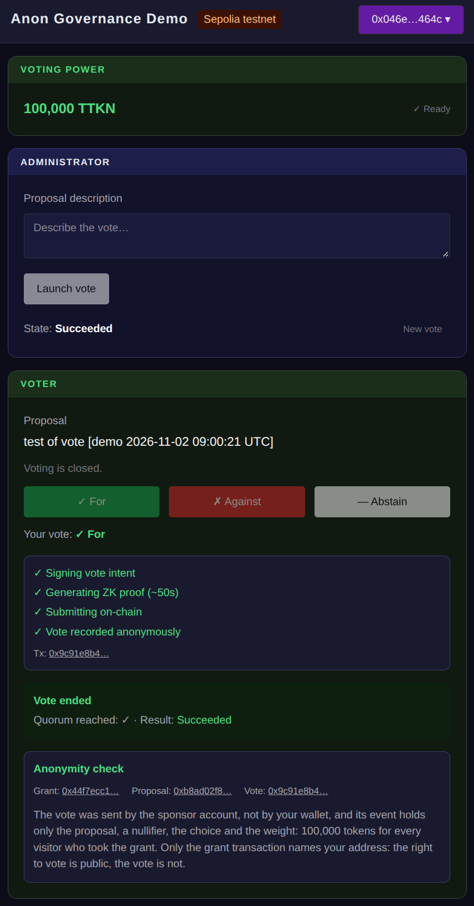
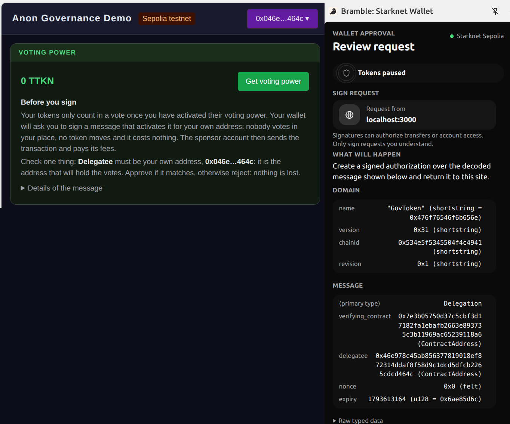
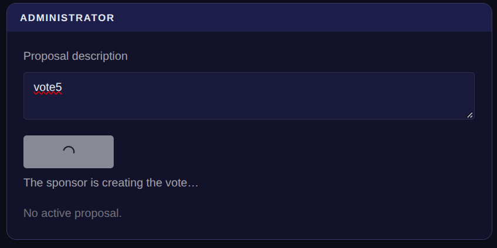
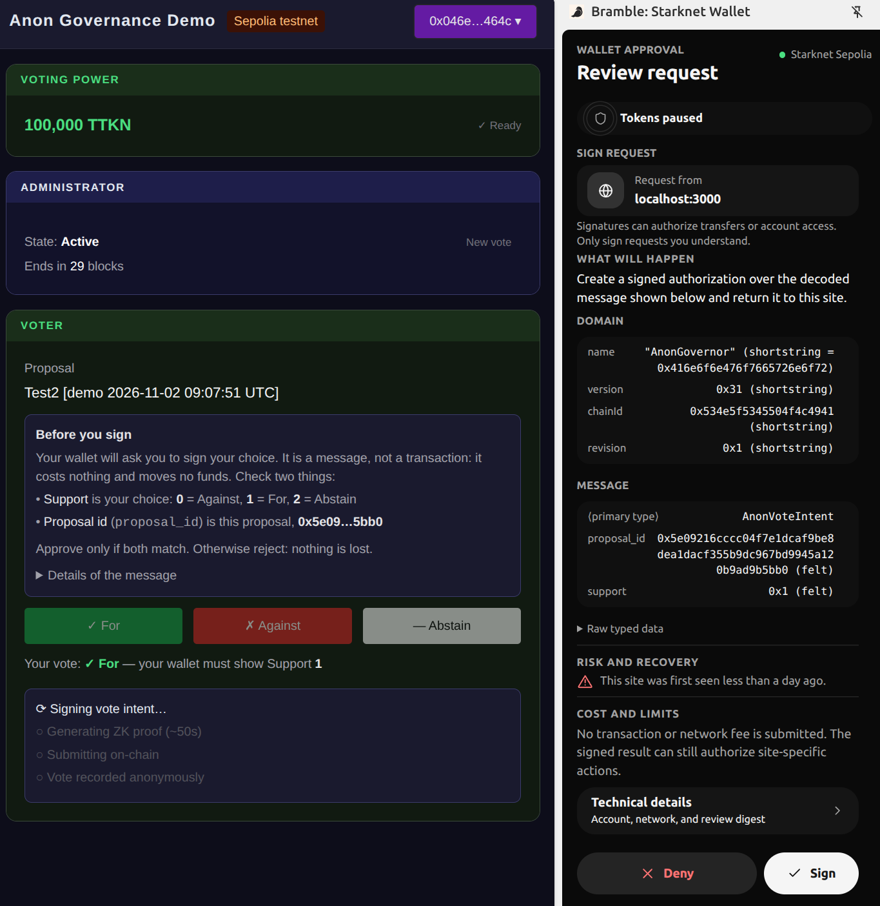
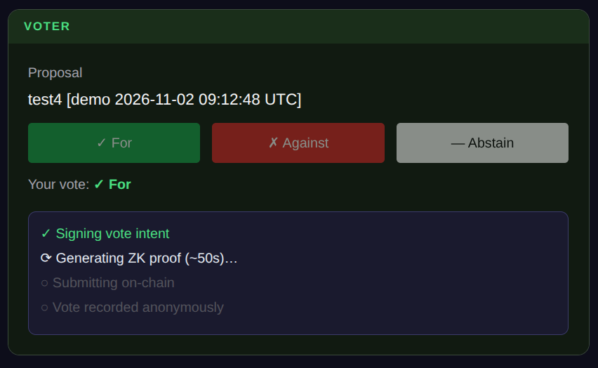

# ERC20 Anonymous Governance DApp

**Vote on an ERC20 governance proposal without anyone seeing who voted what.**

A demo of [SNIP-36 — In-Protocol Proof Verification](https://community.starknet.io/t/snip-36-in-protocol-proof-verification/116123) on Starknet. Your vote is proven off-chain with a zero-knowledge proof and submitted by a sponsor account: the chain records a nullifier, a choice and a weight, never the voter.

<p align="center">
  
</p>

> [!NOTE]
> Experimental / research project: `GovernorCountingAnonymousComponent` is not audited. The DApp runs on Starknet Sepolia or Mainnet, chosen by configuration.

**Contents** — [The demo in four steps](#the-demo-in-four-steps) · [Good to know](#good-to-know) · [Run it yourself](#run-it-yourself) · [How it works](#how-it-works) · [Lessons learned](#lessons-learned) · [Related projects](#related-projects)

---

## The demo in four steps

Connect a Starknet wallet that is already deployed. From then on, your wallet **never sends a transaction**: it signs two messages, and a backend account, the **sponsor**, sends and pays for everything.

| Step | Your wallet | The sponsor sends |
|---|---|---|
| 1. Activate your voting power | signs a `Delegation` message | `mint` + `delegate_by_sig`, in one transaction |
| 2. Create a vote | nothing | `propose` |
| 3. Vote | signs an `AnonVoteIntent` message | `cast_anonymous_vote`, with the ZK proof |
| 4. Check the anonymity | nothing | nothing: the page links the three transactions |

### 1. Activate your voting power

<p align="center">
  
</p>

Governance tokens only count in a vote once their votes are activated (*delegated*, in ERC20Votes terms). Click **Get voting power** and sign one message: the sponsor mints you 100,000 TTKN, the quorum, so that your vote alone can decide, and activates them for your own address. No token moves and it costs you nothing. The page tells you the one thing to check in your wallet: **Delegatee** must be your own address.

### 2. Create a vote

<p align="center">
  
</p>

Type a description (200 characters at most) and click **Launch vote**. The sponsor creates the proposal; your wallet signs nothing. A UTC time mark such as `[demo 2026-11-02 09:00:21 UTC]` is appended, because a proposal id is the hash of its description: two visitors typing the same text would otherwise share a proposal. Voting opens one block later; until then the page shows *Waiting for the voting window to open (block N, now M)…*

### 3. Vote

<p align="center">
  
</p>

Choose **For**, **Against** or **Abstain** and sign. Above the buttons, *Before you sign* lists what your wallet shows: **Support** (0 = Against, 1 = For, 2 = Abstain) and the **Proposal id**, shortened the way wallets shorten it. The proof server then computes the zero-knowledge proof (40–50 s, plus any wait in its queue) and the sponsor submits the vote with it.

<p align="center">
  
</p>

### 4. Check the anonymity

Once the vote is recorded, the result appears under it, followed by an **Anonymity check** box that links the three transactions of your journey (see the picture at the top). Open them on the explorer and compare:

- the **grant** is the only transaction that names your address: it is public that you may vote;
- the **vote** is sent by the sponsor, and its `AnonymousVoteCast` event holds only the proposal, a nullifier, the choice and the weight. The choice is public, but nothing links it to you.

> [!TIP]
> Every step has a **Try again** button: a wallet sometimes answers too late, and a retry fixes it.

## Good to know

- **Deployed account required.** The token checks your signature through your account contract (SRC-6), so the account must exist on-chain. An undeployed wallet is asked to deploy it first (any transaction does it).
- **One grant per address.** An address that already has voting power is refused. Tokens received another way (a transfer) are only activated, and the sponsor mints what is missing to reach 100,000.
- **Anyone can create a vote.** The governor only asks the proposer for `proposal_threshold` votes, and the proposer is the sponsor.
- **Cost.** Each visitor costs the sponsor three transactions (grant, proposal, vote), paid in STRK: real money on Mainnet. There is no rate limit: the sponsor's balance and the proof server's daily quota are the caps.
- **Short voting window.** On the demo deployment a vote stays open 50 blocks (roughly 80 seconds) and a proof takes 40–50 seconds: vote as soon as the window opens.
- **Anonymity set.** The vote hides *which* eligible voter cast it, not that a vote happened. A visitor usually creates their own proposal and is its only voter, so timing alone links the grant to the vote: the demo shows what the transactions reveal, not the privacy of a crowd.
- **One choice, one nullifier.** The nullifier stops the same signature from counting twice. The choice is part of the signed message, so a voter who signs another choice gets another nullifier, and the contract counts it (a known limit, documented in the contract). The DApp never offers a second vote.
- **A clean page at each connection.** Connecting a wallet, even the same one, or reloading starts from a clean page. Only the hash of each address's grant transaction is kept in the browser.
- **Network guard.** The badge next to the title shows the network the DApp runs on. If your wallet is on another one, a red banner says so and the panels are hidden: switch networks in your wallet (the DApp never asks it to, some wallets refuse), then reconnect.

---

## Run it yourself

### Prerequisites

| Requirement | Details |
|---|---|
| Starknet wallet | Any wallet that signs SNIP-12 typed data, on the DApp's network (tested with Ready X, Bramble and Xverse) |
| Alchemy | An API key: the RPC URL is derived from it and from the network |
| Proof server | A SNIP-36 proof server with one instance per network, and an API key for its public address (see [Proof server](#proof-server)) |
| Backend account | Address + private key on the chosen network, funded with STRK. It is the **sponsor**: it must own the GovToken (the grants mint tokens) and it pays for every transaction |
| Node.js | v22.12+ (required by starknet.js v11) |

### Setup

1. **Clone and install**

   ```bash
   git clone https://github.com/PhilippeR26/ERC20-anonym-governance-DAPP
   cd ERC20-anonym-governance-DAPP
   npm install
   ```

2. **Configure** — copy `.env.local.example` to `.env.local` and fill it in:

   ```env
   # Public — exposed to the browser
   NEXT_PUBLIC_NETWORK=sepolia            # or mainnet

   # Server only — never exposed to the browser
   ALCHEMY_API_KEY=<key>
   SEPOLIA_BACKEND_ACCOUNT_ADDRESS=0x...  # only the account of the active network is read
   SEPOLIA_BACKEND_ACCOUNT_PRIVATE_KEY=0x...
   MAINNET_BACKEND_ACCOUNT_ADDRESS=0x...
   MAINNET_BACKEND_ACCOUNT_PRIVATE_KEY=0x...
   PROOF_SERVER_URL=https://<name>.duckdns.org   # the DApp appends /sepolia or /mainnet
   PROOF_SERVER_API_KEY=<site key>
   ```

   `PROOF_SERVER_API_KEY` is sent as `Authorization: Bearer <key>` and stays server-side. A missing variable, or a proof-server instance that proves the other network, shows up in a red banner at the top of the page.

3. **Start**

   ```bash
   npm run dev   # then open http://localhost:3000
   ```

   A proof takes about 40–50 seconds; its duration is logged in the Next.js server console.

### Choosing the network

A single branch, `main`, runs on either network, chosen by `NEXT_PUBLIC_NETWORK` in `.env.local`:

| | `sepolia` | `mainnet` |
|---|---|---|
| Badge in the header | Sepolia testnet | Mainnet |
| Wallet must be on | Starknet Sepolia | Starknet Mainnet |
| RPC | Alchemy Sepolia (from `ALCHEMY_API_KEY`) | Alchemy Mainnet (from `ALCHEMY_API_KEY`) |
| Backend account | `SEPOLIA_BACKEND_ACCOUNT_*` | `MAINNET_BACKEND_ACCOUNT_*` |
| Proof-server instance | `<PROOF_SERVER_URL>/sepolia` | `<PROOF_SERVER_URL>/mainnet` |
| Block explorer | sepolia.starkscan.co | starkscan.co |

The GovToken and AnonGovernor addresses of each network are built into `src/app/utils/network.ts` (they can be overridden, see `.env.local.example`). `NEXT_PUBLIC_NETWORK` is read at build time: restart `npm run dev` after changing it.

### Deploying on Vercel

> [!IMPORTANT]
> **[Not validated]** Not tried yet.

- **One Vercel project per network.** `NEXT_PUBLIC_*` values are inlined into the browser bundle at build time: changing the network means changing the variable and redeploying. To serve both networks, create two projects from the same repository with different variables.
- **Variables**: those of `.env.local.example`; the red banner lists the missing ones. The DApp always uses the proof server's public address and its API key, never its local-network listener.
- **Duration.** The vote route declares `maxDuration = 300` seconds. According to the Vercel documentation (read on 2026-10-30, page updated 2026-08-24), with Fluid compute (enabled by default) 300 s is the maximum of the Hobby plan (800 s on Pro). A proof takes 40–50 s plus any wait in the proof server's queue. The documentation does not say what the browser receives when a streamed response is stopped at the limit, and the vote stream sends nothing while the proof is computed: **[Not validated]** whether an intermediary cuts such a silence.
- **The four public routes use the server's keys, or the sponsor's funds, for whoever calls them.**
  - `/api/vote` runs free on-chain reads first (the proposal is Active, and `create_proof` runs as a read: voter signature, voting power at the snapshot, nullifier unused), so a request the contract would refuse never reaches the proof server or its daily quota. A valid request sent again while its vote is not yet recorded can still cost extra proofs; the proof server caps this (2 simultaneous requests and a daily quota per site).
  - `/api/rpc` relays only the six methods the DApp uses, and `starknet_call` only on the governor and the token; anything else gets a JSON-RPC error and a warning in the server log.
  - `/api/faucet` and `/api/propose` send transactions from the sponsor. A request the contract would refuse (bad signature, account not deployed, empty description…) is stopped before anything is sent and costs no STRK, but a valid one is paid by the sponsor, with no rate limit: keep on the backend account only what the demo can afford to lose. Both routes declare no `maxDuration`, and `/api/propose` may wait for the sponsor's one-time self-delegation to be accepted (a few seconds to some tens of seconds): **[Not validated]** that the platform's default duration is enough on your Vercel plan.
  - None of these routes limits the number of requests: each refused request still costs a few Alchemy reads, within Alchemy's own limits.

---

## How it works

### Architecture

```
Browser (Next.js DApp)
    │
    ├── Wallet (Ready X, Bramble…)      ← connects and signs SNIP-12 messages only
    │
    ├── /api/rpc                        ← RPC proxy (keeps the RPC key server-side)
    │
    ├── POST /api/faucet                ← sponsor sends mint + delegate_by_sig
    ├── POST /api/propose               ← sponsor sends propose
    │
    └── POST /api/vote (streams progress events)
            │
            ├── backend Account         ← builds a signed virtual INVOKE_TXN_V3
            │
            └── SNIP-36 proof server (instance of the active network)
                    │
                    ├── Runs create_proof() in the SNIP-36 virtual OS
                    └── Returns { proof, proofFacts, l2ToL1Messages }

On-chain (Starknet Sepolia or Mainnet)
    ├── GovToken (ERC20 + vote checkpoints)
    └── AnonGovernor
            ├── cast_anonymous_vote()   ← submitted by the sponsor
            └── verifies the proof facts via SNIP-36
```

A single starknet.js package, `starknet@11.4.3`, is used on both sides:

| Side | Role |
|---|---|
| Client | `WalletAccountV6` (get-starknet v6), reads, nullifier check |
| Vote route (`/api/vote`) | Backend `Account`: `getSignedTransaction()` for the virtual tx, `execute()` with the proof for the vote |
| Grant and proposal routes (`/api/faucet`, `/api/propose`) | The sponsor, a backend `Account`: `execute()` of `mint` + `delegate_by_sig`, and of `propose` |

The get-starknet packages are pinned to `6.0.6`, the exact version starknet.js 11.4.3 depends on, so that the wallet object passed to `WalletAccountV6.connect()` is typed from a single copy of `@starknet-io/get-starknet-wallet-standard`.

### Contracts

The governance system is deployed from [ERC20-anonym-governance-vote](https://github.com/PhilippeR26/ERC20-anonym-governance-vote).

**GovToken** — an ERC20 governance token with voting power checkpoints (`VotesComponent`). Every transfer updates checkpoints via `after_update`. A holder's tokens only count in a proposal once delegated (to themselves or to another address).

**AnonGovernor** — manages the proposal lifecycle and replaces standard vote counting with `GovernorCountingAnonymousComponent`:

- `cast_vote*` functions are disabled: they always panic with `'Use cast_anonymous_vote'`.
- `cast_anonymous_vote(public_message)` has **no caller check**: any account can submit it. Anonymity comes from the SNIP-36 proof, not from restricting the submitter.
- `create_proof()` takes `voter: ContractAddress` explicitly and verifies the voter's signature through `account.is_valid_signature()` (SRC-6) against the SNIP-12 hash. The backend account can thus sign the virtual transaction while the voter's identity is checked through their own signature.
- `proposal_votes()` does **not** exist: vote counts are internal storage. Only `quorum_reached(proposalId)` and `vote_succeeded(proposalId)` are publicly readable.

The AnonGovernor depends on a fork of the OpenZeppelin Cairo contracts:

```toml
openzeppelin = { git = "https://github.com/PhilippeR26/OZ-contracts", branch = "anon-vote-frontend" }
```

### Sponsored grant and proposal

Two routes bring a visitor to the vote without a single wallet transaction. Both send from the **sponsor** (the backend account, built by `getSponsor()` in `src/app/server/sponsor.ts`) and report errors as data (`{ error }`, HTTP 400), like `/api/vote`.

- **Grant — `POST /api/faucet`** (`src/app/server/grantVotingPower.ts`). The browser sends `{ address, nonce, expiry, signature }`, the signature being the visitor's SNIP-12 `Delegation` message (`verifying_contract`, `delegatee`, `nonce`, `expiry`) in the token's domain (`GovToken`, version `0x31`, revision 1). The route checks that the account is deployed and has no voting power yet, then sends one transaction: `mint(address, missing)` (`missing` brings the balance to 100,000; the call is left out when nothing is missing, for tokens received by a transfer) and `delegate_by_sig(address, address, nonce, expiry, signature)`. `delegate_by_sig` has no caller restriction: it checks the signature through the delegator's account (`is_valid_signature`) and the `expiry` (one hour here) against the block time, so the sponsor can submit it for the visitor.
- **Proposal — `POST /api/propose`** (`src/app/server/createProposal.ts`). The browser sends `{ description }`; the route trims it (1 to 200 characters), appends a UTC time mark and sends `propose` from the sponsor. It answers `{ proposalId, description, transactionHash }`, where `proposalId` is `hashProposal(description)`. The governor reads the proposer's votes one block before the proposal, so the sponsor must itself hold at least `proposal_threshold` votes: the route reads `get_votes(sponsor)` and, if they are lower, sends `delegate(sponsor)` and waits for it to be accepted before proposing. On the demo deployment on Sepolia this happened once, on the first proposal (the sponsor's tokens were delegated to a test wallet, which lost those votes); on Mainnet the sponsor is already self-delegated.
- **Refusals.** When the contract refuses a call, the node reports the panic reason inside an RPC error: code 40 for a call, 41 for a failed fee estimation (which is where a refused transaction stops, before anything is sent). `contractReason()` (`src/app/server/contractReason.ts`) takes the last `('…')` of that error, so the visitor reads "Grant refused: …" or "Proposal refused: …" instead of a node dump.

### The anonymous vote, step by step

#### 1. Sign the vote intent (wallet)

The voter signs a SNIP-12 typed message, `AnonVoteIntent { proposal_id, support }` (0 = Against, 1 = For, 2 = Abstain), in the governor's domain (name `AnonGovernor`, version `0x31`, the chain id, revision `1`). No gas is spent. The signature never appears on-chain: it goes to the DApp's server and to the proof server as the private input of the proof, and it serves twice:

- **Identity proof** — `create_proof` checks it through the voter's account contract (`is_valid_signature`, SRC-6).
- **Nullifier seed** — `poseidon(NULLIFIER_DOMAIN, proposal_id, poseidon(signature))` gives a one-time nullifier per proposal. The signing scheme must be deterministic (RFC 6979), as in OpenZeppelin and Ready accounts.

<details>
<summary>SNIP-12 encoding detail</summary>

The domain `version` must be `CairoBytes31.fromText("1").toHexString()` = `"0x31"`, not the integer `"1"`: `"1"` produces a different hash, and `is_valid_signature` then fails with `Result::unwrap failed.` in the proof server. Likewise, `chainId` must be the hex value returned by `wallet_requestChainId` (e.g. `"0x534e5f4d41494e"` for Mainnet), not the string `"SN_MAIN"`.

</details>

#### 2. Prove (vote route + proof server)

The browser calls the streaming route `POST /api/vote` with `{ proposalId, support, voterAddress, signature }`. The route first runs the free on-chain reads described in [Deploying on Vercel](#deploying-on-vercel), then checks that the proof-server instance proves the DApp's network (`GET /health`), and streams the queue position back to the page while the proof runs:

1. With `Account.getSignedTransaction()`, the backend account builds a signed `INVOKE_TXN_V3` calling `create_proof(proposal_id, support, voter, AnonVotePrivateInput { signature })`. This **virtual transaction** is never broadcast. The prover requires a maximum possible fee of zero, so every `max_price_per_unit` and the `tip` are `0`; the gas **amounts** (`max_amount`) must stay non-zero, or `__validate__` panics with `'Out of gas'` before `create_proof` runs.

   > [!WARNING]
   > **Never use `estimateFee()` for this virtual transaction.** Its calldata holds the voter's address and their signed choice: estimating the fee would send them to an RPC node for simulation, exposing who votes and what before the proof even exists. The resource bounds are therefore hardcoded to safe upper bounds.

2. The proof server ([below](#proof-server)) runs `create_proof` in the SNIP-36 virtual OS, which:
   - verifies the voter's signature through the voter's account;
   - reads the voter's **past voting weight** from the token checkpoint at the proposal snapshot (on-chain state, not supplied by the voter: it cannot be forged);
   - computes the nullifier;
   - builds `AnonVoteMessage { proposal_id, nullifier, support, weight }` and hashes it as an **L2→L1 message**, a tamper-proof commitment the contract checks against the proof facts;
   - returns `{ proof, proofFacts, l2ToL1Messages }`.
3. The route decodes the public message from `l2ToL1Messages` and calls `backend.execute(cast_anonymous_vote(publicMessage), { proof, proofFacts })`.

#### 3. Cast (sponsor)

`cast_anonymous_vote(public_message)` is submitted by the **sponsor** with the SNIP-36 proof attached. The contract:

1. reads the proof facts from `get_execution_info_v3_syscall` (the SNIP-36 mechanism);
2. recomputes the message hash from `AnonVoteMessage` and checks it against the proof facts;
3. checks that the nullifier has not been used;
4. marks the nullifier as used and tallies `{ nullifier, weight, support }`.

The voter's identity never appears on-chain. The choice does, in the public event, but nothing links it to the voter: the nullifier cannot be traced back to an address.

### Proof server

`src/app/server/requestProof.ts` sends the signed virtual transaction to a SNIP-36 proof server: [secure-voty/proofServer](https://github.com/PhilippeR26/secure-voty) (branch `proof-server-v2`), a server around the `snip36` CLI of [snip-36-prover-backend](https://github.com/starknet-innovation/snip-36-prover-backend). It runs **one instance per network**, each with two listeners:

| Listener | Address | Access |
|---|---|---|
| Public, HTTPS (behind Caddy) | `<PROOF_SERVER_URL>/sepolia`, `<PROOF_SERVER_URL>/mainnet` | `Authorization: Bearer <PROOF_SERVER_API_KEY>`; daily quota per site and per network |
| Local network | `http://<machine>:<port>`, one port per network | no key, no quota |

The DApp uses the public listener: `PROOF_SERVER_URL` is the base address and the DApp appends the instance path of the active network. The site that owns the API key needs a quota on each network you use; it is created on the proof server (`./proof-server.sh site add ...`). The proof server's address is never shown to visitors (banner, vote errors): it is written to the server log only.

<details>
<summary>The proof-server API, as the DApp uses it</summary>

```
GET  <instance>/health    → { "ok": true, "network": "sepolia", ... }

POST <instance>/prove
Authorization: Bearer <key>          (public listener only)

{ "blockNumber": <reference block>, "tx": <INVOKE_TXN_V3: tip=0, all max_price_per_unit=0, non-zero max_amount> }
```

- The DApp calls `/health` before every vote and when the page loads, and refuses to go on if the instance proves another network (such a proof would be useless on-chain).
- `/prove` answers with a Server-Sent Events stream: `queued` (`{ position, etaSec }`, shown in the vote stepper), `started`, `log` (prover output, local listener only), `done` (`{ proof, proofFacts, l2ToL1Messages }`), `error` (`{ message }`).
- A refusal before the stream (quota used up, bad key, server busy…) is a JSON `{ reason, error }`, with a `Retry-After` header when known; the DApp shows it as is.
- The announced wait only counts the proofs ahead of the vote, not its own proof (about 40–50 s): if the wait plus 60 s exceeds the time left in the vote's budget, the vote stops at once with a clear message.
- The reference block is the chain head (`REFERENCE_BLOCK_LAG = 0` in `src/app/utils/constants.ts`; raise it if a prover rejects blocks too close to the head).
- `PROOF_SERVER_API_KEY` is required: a request without a key would only be refused.

</details>

> The Starknet Foundation prover gateway no longer works for this DApp, and the [Starkscan prover](https://starkscan.co/docs/api/strk20-prover) only proves STRK20 transactions: neither is used.

### Proposal lifecycle

```
propose → [voting_delay blocks] → Active → [voting_period blocks] → Succeeded / Defeated
                                                                          ↓
                                                                       execute
```

| State | Description |
|---|---|
| `Pending` | Waiting for `voting_delay` to elapse |
| `Active` | Voting window open |
| `Succeeded` | Quorum reached and For > Against |
| `Defeated` | Quorum not reached, or Against ≥ For |
| `Executed` | On-chain calls dispatched |
| `Canceled` | Canceled by the proposer or the owner |

`gov.state(proposalId)` returns a `CairoCustomEnum` in starknet.js v11: use `.activeVariant()` to get the state's name.

### Nullifier and replay protection

Before asking for a proof, the DApp computes the nullifier in TypeScript (replicating the Cairo `_compute_nullifier` with Poseidon) and calls `is_nullifier_used(proposalId, nullifier)`: if it is already used, the vote stops at once, without spending a proof (40–50 s). The contract also rejects any vote with a known nullifier. `has_voted(proposalId, voterAddress)` always returns `false`: it is meaningless in an anonymous scheme. See [Good to know](#good-to-know) for the limit of a nullifier derived from the signature.

### Demo state in the browser

The demo journey lives in memory for one wallet connection: connecting a wallet, the same one or another, starts from a clean page, and so does a reload. `proposalStore` (Zustand, not persisted) holds the current proposal (`proposalId`, `description`), what was read from the chain about it, and the hashes of the proposal and vote transactions (`proposalTxHash`, `voteTxHash`, which feed the anonymity check); a new proposal clears everything of the previous one. The panels also start afresh for each proposal (vote panel, proposal form, proposal status) and for each account (voting-power panel): they are remounted with a React `key`. An answer that arrives after its journey ended (a vote confirmed after its proposal was replaced, a proposal or a voting power confirmed for a wallet that is no longer connected) is dropped.

Only `grantStore` is kept in localStorage, under `"anon-governance-grants-v1-<network>"`: the hash of the grant transaction of each address, a permanent on-chain fact that the anonymity check links to. If its shape changes in a way old data cannot satisfy, increment the key version to clear stale data.

---

## Lessons learned

### Proof generation requires a dedicated backend

Generating a SNIP-36 proof requires a native Rust prover: about **2 GB of RAM** at peak with the low-memory prover, ~10 GB of disk for its dependencies, and **40–50 seconds** per proof on a 4-core laptop. It cannot run in a browser, so it needs a backend: here the proof is delegated over HTTP to a separate [proof server](#proof-server).

### Starknet wallets are not SNIP-36 friendly

Current Starknet wallets are not designed for SNIP-36 and block the flow at two points:

- **They cannot produce a raw signed `INVOKE_TXN_V3`**, which the proof server needs to run `create_proof`. Obtaining it requires `Account.getSignedTransaction()` (standard starknet.js since v10.3.0), which signs with the account's private key: no wallet exposes this.
- **They cannot submit the vote anonymously.** `WalletAccountV6.execute()` only accepts a call array. Its `executeWithProof()` (get-starknet v6 wallet API, designed for STRK20) can attach a SNIP-36 proof, but submitting `cast_anonymous_vote` from the voter's own account would make the voter the visible sender.

So the backend account, a standard `Account` from `starknet@11.4.3` with its own key pair and STRK balance, builds the virtual transaction and submits the vote; the voter's wallet only signs. The virtual transaction is never broadcast and has zero gas prices, so only the final `cast_anonymous_vote` costs STRK. Until wallets expose SNIP-36 primitives natively, anonymous voting needs such an off-wallet execution path for everything after the SNIP-12 signature.

---

## Related projects

| Project | Description |
|---|---|
| [ERC20-anonym-governance-vote](https://github.com/PhilippeR26/ERC20-anonym-governance-vote) | Cairo contracts: GovToken + AnonGovernor |
| [OZ-contracts fork](https://github.com/PhilippeR26/OZ-contracts) (`anon-vote-frontend` branch) | OpenZeppelin fork with `GovernorCountingAnonymousComponent` |
| [secure-voty](https://github.com/PhilippeR26/secure-voty) (`proof-server-v2` branch) | The SNIP-36 proof server |
| [starknet.js](https://github.com/starknet-io/starknet.js) | The JavaScript library used on both sides |
| [starknet.js-workshop-typescript — Starknet142-Sepolia](https://github.com/PhilippeR26/starknet.js-workshop-typescript/tree/main/src/scripts/Starknet142/Starknet142-Sepolia) | TypeScript usage examples (scripts 26–28) |

## License

MIT
